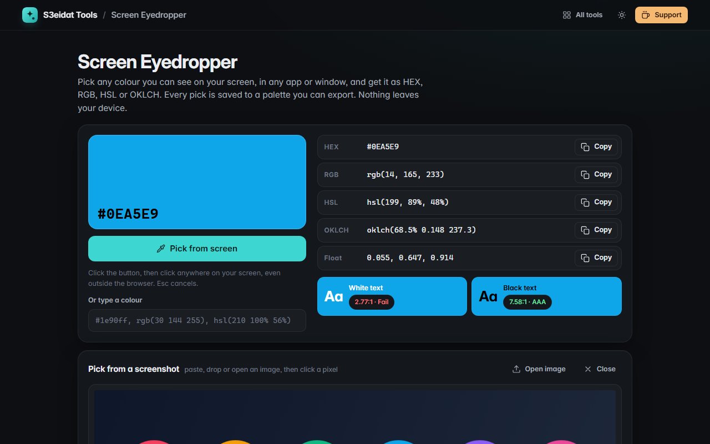

# Screen Eyedropper

> Pick any colour from your screen and get it as HEX, RGB, HSL or OKLCH. Free, private, and it runs entirely in your browser.

### ▶ [Open Screen Eyedropper](https://s3eidat.github.io/screen-eyedropper/)



## Features

- **Pick from anywhere on screen**, even outside the browser, using the EyeDropper API (Chrome, Edge and Opera on desktop).
  The picker only opens when you click the button.
- **Any browser:** paste or drop a screenshot and pick from it with a **magnifier**; arrow keys move one pixel, Enter picks
- **HEX, RGB, HSL, OKLCH** and 0–1 float values, each with one-click copy; picks are copied as HEX automatically
- **Contrast check** of white and black text on the colour (WCAG ratio, AA / AAA)
- Type or paste any CSS colour (`#1e90ff`, `rgb(…)`, `hsl(…)`, names) to convert it
- A **palette** of every colour you pick, saved in this browser; export it as **CSS custom properties** or **JSON**

## Privacy

Nothing leaves your device. The browser's own eyedropper returns only the one colour you click; screenshots are read in
this tab and never uploaded. There is no server, no account, no analytics. The page ships with a strict
Content-Security-Policy (`connect-src 'self'`), so the browser itself blocks any attempt to send data anywhere.
Your palette is stored only in this browser's local storage.

## Run it yourself

It's plain HTML, CSS and JavaScript with no build step:

```bash
git clone https://github.com/s3eidat/screen-eyedropper
cd screen-eyedropper
python -m http.server 8000
```

Then open http://localhost:8000.

## Support

If this saved you time, **[buy me a coffee ☕](https://s3eidat.github.io/coffee/)**. It keeps every tool free.

---

Part of **[S3eidat Tools](https://s3eidat.github.io/)**: 100+ free, private tools that run in your browser. MIT licensed.
